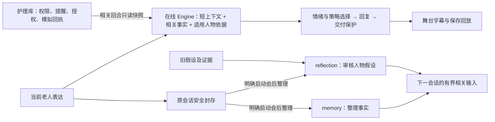

# 念念 / Niannian · 产品与第一版本边界

当前状态、任务和下一步只看 [PROGRESS](PROGRESS.md)。本页说明产品约定与架构；
实现是否完成不能由这里的设计描述推断。它收束了原重聚焦方案的最新决定，历史全文已归档。

版本阅读说明（2026-10-26）：当前入口是 `release_deepseek_v1`（DeepSeek/Together、v7、零付费自动重试）；会后DeepSeek须通过同一组元数据与显式路由选择，未选择时保留历史Sonnet选项。实际装配以 [release.py](../aria/release.py) 和 [runtime.py](../aria/runtime.py) 为准；执行范围、验收结果与预算只看 [PROGRESS](PROGRESS.md)。本人确认的偏好与系统推断的人物假设是不同能力，前者通过不能代替后者形成、纠正和使用的证据。

## 要解决的问题

老人可能愿意表达，却不愿被替他安排。念念希望跨会话理解“他接受怎样的沟通、
如何表达脆弱”，并在新证据出现时修正理解。重点是回应与行动的选择，包括先问、停下、
不做；记住经历和给情绪贴标签都不能单独替代这一能力。

产品方向是三件事：**本人能确认和纠正的相处说明、回应前的简短推演、只转达他同意分享的内容。**
这是设计目标，不是已经证明的竞争优势。本人明说的偏好、系统推断的人物假设应分开保存；
`stated_preference` 的设计见 [STATED_PREFERENCE](STATED_PREFERENCE.md)；它及转达体验的实际实现状态见进度。

## 必须分开的信息

| 信息 | 用途和边界 |
| --- | --- |
| 事实 | 他实际说过的经历、安排等；保留原话及会话/轮次来源 |
| 本人确认的偏好 | 有原话、复述确认和适用范围；当前意愿优先，允许撤回 |
| 推断型人物假设 | 有支持、反证、范围、置信与纠正轨迹；候选不自动当事实使用 |
| 当前情绪 | 根据当轮表达判断，允许不明；缺声学/视觉时不伪造观测 |
| 护理状态 | 来自护理库的只读依据，不能变成人物证据或本轮执行回执 |
| 权限与授权 | 指定对象、触发条件、分享范围和有效期；人格不能改变权限 |

DISC、Big Five、依恋、CBT 等是理解框架，不是诊断或永久标签。不主动盘问敏感隐私。
无新证据时理解可以保持不变，不为三会话演示降低门槛或伪造跨天时间。

## 两条推理线

当前在线使用DeepSeek/Together；memory与reflection仍是不同职责，当前评测显式选择同一DeepSeek/Together会后路由。
reflection审核原会话、旧假设与证据，不继续推理memory的摘要，也不把在线模型自己的判断当新证据。
支持人物假设须有原始交付、本人响应和可核对的事件来源；未知往事不因换个说法就算新事件。
本人原话构成的有效反证可以降低或退役旧假设，不要求先证明旧事发生日期；支持门槛保持。
当前结构化memory在同一次审阅中区分认知隐私与一般私密事实：普通情绪、生活选择和关系说明本身不构成认知功能变化。真正认知隐私仍按C1设计从普通记忆及人物反思排除，逐字出处核对不能代替语义正确性；本次提示修订是否降低误排除另按新版实跑验证。
事实能否在与本人对话时主动引用，与能否对外分享分别判断。单次选句或外传范围限制不能自动扩大为全部事实的内部禁引；真正保密、私密、敏感及本人明确不愿再提的内容仍受限制。可引用的事实也不因此获得对外分享授权。
会后不阻塞整段在线交互：已经发出的物理请求须先结算，随后在线输入优先于下一次会后调用。
等待期间急症先行保护仍即时交付；这不代表免费或本地部署。

当前同一DeepSeek/Together会后路线的reflection使用单一strict Schema与原有流式传输，
审查标识由代码按原数组位置生成，change只引用对应位置；本地仍逐项核对形状、原话、范围、事件身份及人物更新事务。
当前结构化memory与reflection各自直接定义职责提示，格式只由同次请求的Schema约束，不再拼接、删改历史自由格式提示。
相处说明的do是完整简洁的交流行为摘要，scope保留完整条件、对象、时限和例外；保存、邀请确认及后续使用始终一起读取两项。
这些表示上的收敛不允许截句、扩大范围、改写本人原话或自动确认，也不表示已证明模型提取和反思正确。
旧Max/Sonnet的schema-free路线及历史body/schema、一次格式更正选项仅供显式复验，
当前发布路线零付费自动重试；证据或语义不成立、拒答、截断、调用失败不冒充格式错误。
失败不改成成功，已有memory/R1结果保留；软件替身验证不能证明上游格式可靠。
同一DeepSeek/Together当前路线的在线回应、记忆、反思、安全复核和确认判断共用已有流式读取器，保持各自原Schema；只有完整结束、用量与结束标记齐备，
当前HTTP分块完整且身份费用核实后才进入交付。应用终态完整与HTTP报文完整分别记录，不接纳半份JSON或重放旧请求。
完整的计费收据与可用的业务内容分别判断：长度截断或空答可以在身份和用量齐备时结算，但不能作为有效正文、记忆或复核；
既有局部失败隔离继续生效。原有限HTTP读取仅供未选择这条当前路线的显式历史配置，不能把SSE当成永不中断的保证。
可安全终结的会后内容失败分别以 `memory_failed` 或 `reflection_failed` 审计封存，不标成整理成功；
memory失败不提交半份事实或偏好，也不继续本次反思；reflection失败保留已完成的memory。
身份与费用已核实、调用已完整落盘且没有部分写入时，失败任务终结，后续新会话可继续，不重发旧请求。
保存、授权、预算或尚未落盘的调用仍停止，不能通过失败封存跳过这些门。

当前v7的护理快照仅在五类记录均空、完整统计证明没有遗漏时使用等价短表示；未配置与已配置仍区分，读取时点、通道和权限状态保留。未知、非空或不完整快照继续使用原表示。此投影只影响本轮提示显示，不修改护理原件或产生动作回执；在线12000字节上限保持，超限仍明确拒发。

默认入口是本地占位；真实文字模型需明确启用。当前在线采用 `online_turn_decision_v7`，只有正文分段与`safety_concern`必填，可选字段失败不抹掉正文。普通短句也在同次调用判断安全；现有一次独立复核同时检查保护适用性、正文有害内容和动作/状态声明；代码提供本轮真实回执及有资格的偏好范围依据。生成模型的段落标签不能单独决定删除整段，复核只删可定位的问题原文，代码回执独立交付。关键词仅作先行条件保护，不能证明主体、时点或现实危机；已交付保护不重复拼回正文，也不能仅凭风险类别或不确定性删除整段有效帮助。格式或来源失效仍不能释放未复核正文。旧协议保留给显式历史复验，当前提示为`compact_response_v1`；
`profile_v1` 多维画像只作显式实验，按[验证设计](VALIDATION.md)决定去留。`v2` 先推演后回复在 E1 中回复更差、延迟超门，2026-10-02 起降为存档实验：代码保留、默认关闭，不再开发。

当前DeepSeek/Together发布路线的复核将正文删句判断与保护模板适用性分别验证；不用的附属字段不连带作废有效判断，
无效风险字段不能默认成无风险，删句判断无效仍扣留正文。传输层核对收据、身份与费用，
应用层核对内容及当前来源。正文复核失败不自行把本人原话标成敏感；既有风险排除、
复核有效提出的风险或不确定判断，以及来源失配继续限制学习，不能因保留原话而获得人物或授权证据。
复核可读取同条偏好记录经来源核对的最近一次本人界面结果，用于理解当前状态；该结果不证明助手本轮执行了新动作。准确说明已撤回状态不要求再执行一次撤回，但危险建议、越权应用和虚构完成声明仍逐句复核，不能凭段落或状态标签放行。

当前 DeepSeek/Together 复核区分“本人没有现实风险线索”与“有具体线索，现实风险仍不明”。对照本轮和所给前文本人的发言定位线索，候选回复的危险建议始终另行审查。在线判断为无风险、当前来源一致且正文完成复核时，复核明确只作条件保护而找不到本人线索，可以保留本人原话。已有风险或隐私排除、有效的不明风险、坏出处及来源漂移仍限制学习。保护话术本身不授予人物或分享权限。

现实危险也可能来自他人，原有四类专用模板并不总适用。在线回应和同一次安全复核都要考虑本人当下能安全采用的求助方式。现行复核选择具体危险时，须从其引用的本人发言中给出对应原句。来源缺失时不用该类专用提示；声称有即时危险而来源缺失、又宣称全文无冲突时，交付条件保护。若在线已核为无信号、没有既有保护，复核明确报告非即刻但无有效出处，不能凭该分类扣掉独立复核过的正文和本人原话。真实风险、隐私和来源一致性仍需分别核对。已准确定位应删片段时，按原边界交付其余可用正文。逐字核对能证明本人说过这句话，不能证明模型对危险类别的解释正确。

当前事实整理从本人发言中选择整轮或带轮次的原文片段，代码核对出处，再写入事实。助手回复与本人原话分列。若同一轮既确认相处约定又讲了生活中的事，记忆模型在同一次整理里分别选出两处原话。保存和主动召回时都核对两者的边界；经历与亲属关系均可保留有独立出处的生活事实。本人撤回后，旧确认不能作为普通记忆再次进入请求。旧档案若只留下整轮确认，且没有可核对的片段边界，保留原记录供本人回看。出处可以逐字核实，是否选中了有意义的生活事实仍须用实际模型回答验收。

本人对旧约定的澄清可以出现在另一次发言中，即使这次没有提出新约定，也要将澄清与同轮的生活事实分开。生活片段选一次即可；无法把它可靠归给某位亲属时，可以作为本人的经历保存。亲属姓名出现在一句话里，本身不足以授权把整句话长期当成该亲属的事实。旧资料的历史回看、正在讨论的本人原话和系统主动调入的普通记忆分别处理。

## 第一版本保留

一个 Web、一个老人陪伴产品。连续会话、来源与纠正、明确会后整理、舞台字幕、可接管输入、
安全回放；护理员登录及负责老人范围、一次性/每日提醒、老人确认/拒绝/延后/取消、
未确认状态、授权撤回、本地模拟通知、回执与跟进关闭。

首发通知采用接口与模拟通道；真实通道及收件人联调后置。普通低落不会自动通知家属，
“未确认”不等于没吃药或遇险。聊天里提到提醒不等于已经执行，实际动作由表单保存。
提醒通知仍只覆盖已授权的提醒状态。本人另可在当前活动会话中选定一整句已保存原话，
核对指定联系人、完整内容与独立本地模拟通道，明确批准后再另点发送；预览五分钟有效。
护理员不能代批，人物假设和变化记录不进入转达，提醒授权也不能批准这句话。
刷新只读取，未知尝试禁止换编号重发；撤回不能保证已开始的发送未被接收。
本地模拟回执不证明真实外发、真人阅读或模型理解，具体版本验证仍只在进度登记。
护理调度独立运行。默认闲置、关闭或退出聊天只封存；本人已明确开启自动整理时，
之后新封存的会话按每日次数与原费用边界执行，不回溯旧会话。

本版本移出摄像头/微表情、声学情绪、ASR/TTS、Omni、全双工、硬件、其他产品场景、
反诈/认知健康独立入口和旧大型研究平台。保留基本安全规则以及必要的小实验、软件验收。

## 演示方向

多轮、多会话、有生活背景，机器人台词来自实际 Agent。老人側只准备可选输入，观众可以接管。
推荐故事仍是陈师傅、女儿、外孙女与纸风车：认识他、允许他纠正、由他决定。
关心方式与老人需要可能错位，不把女儿写成反派；老人选择安静也是合格结局。

生活片段短片与轻量互动舞台是同一产品的表现方式。固定房间、风车、旧本子及简单动作可以
承载故事；最终美术、配音、片名未由这些建议自动确定，不另造模拟老人模型。
预置示意、真实生成与保存回放必须分清；模型失败不偷换预写回复，动画不回灌感知证据。
剪辑不能冒充实时速度，回放/快进/重播不能再调用模型或执行提醒通知。

开源项目名为“念念”，英文名为 Niannian。仓库交付采用经过审查的
干净发布树；已获授权的私有仓库交付与其验证结果见 [PROGRESS](PROGRESS.md)。本地开发、
清理、打包和私有交付本身均不授予公开发布或公开部署权限。

## 已纳入的可选能力与历史评估

**外部情绪读数接口。**（20261002-04 修订）用户的系统里单独部署了情绪模型。为了让测试贴近该系统，产品新增 EM-1 外部情绪接口：每轮可以传入一个读数（标签、置信度、来源），在线提示把它当作“可能有误的外部读数”，读数不能盖过本人原话，不能用来断言他的情绪，也不进入人物证据；没有读数时行为与现在完全相同。E1b 用模拟读数（带噪声，两臂相同）运行，见 [VALIDATION](VALIDATION.md)。接口不自行启动情绪模型；真实上游的标签映射、来源标记和联调须另行完成，不能把接口的软件验证说成情绪识别效果。

**记忆与日常变化提醒（原“阿尔茨海默症识别预防”）。** 2026-10-02 用户决定现在就做，定位是提醒、不诊断，设计见 [COGNITIVE_CHANGE](COGNITIVE_CHANGE.md)。下文保留 20261002-03 的评估作为依据。

*20261002-03 评估原文：* 不建议用“识别”来讲故事。理由：
- 识别或筛查属于医疗用途，按医疗器械软件监管，需要临床验证。项目不采集真人资料，做不了这种验证。
- 网上的成熟案例多是基于语音和语言特征的研究分类器（如 DementiaBank、ADReSS 一类数据），或者 AD8、MoCA 等量表。它们在整理好的数据上效果不错，换到新人群、新语言后往往明显下降，中文老人数据更少。
- 我们的框架理解的是相处方式和偏好，没有经过验证的认知测量，**没有依据说接入后会更准**。
- 与核心主张冲突：产品讲的是“尊重他、不给他贴标签、只转达他同意的内容”，而“识别痴呆”是监测和贴标签。误报会让老人和家人焦虑。

可以做、也更贴合主线的是**“留意变化，不下诊断”**：
- 本人开启后，跨会话和他自己的过去比较（例如同一件事反复提起，常用安排忘得更频繁）；
- 只对本人温和说出观察，问他是否愿意和医生聊；
- 告不告诉家人由他决定，不出分数，不出病名。

“预防”方面，可以如实讲社交参与：减少社会隔离是公认可改变的痴呆风险因素之一（如 Lancet 委员会 2024 报告）。但这只能说陪伴有助于社交，不能宣称预防效果。

（原建议放在首发之后；用户 2026-10-02 决定现在就做，按“提醒、不诊断”设计。仍建议商用前做医学审阅。）故事上可以保留一个不下结论的片段：他忘了约定，念念不贴标签，只问他要不要设一个由他自己掌控的提醒。
