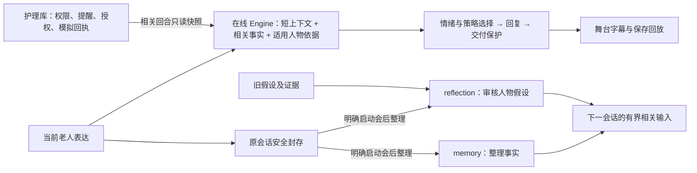

# Aria：产品与第一版本边界

当前状态、任务和下一步只看 [PROGRESS](PROGRESS.md)。本页说明产品约定与架构；
实现是否完成不能由这里的设计描述推断。它收束了原重聚焦方案的最新决定，历史全文已归档。

## 要解决的问题

老人可能愿意表达，却不愿被替他安排。Aria 希望跨会话理解“他接受怎样的沟通、
如何表达脆弱”，并在新证据出现时修正理解。重点是回应与行动的选择，包括先问、停下、
不做；记住经历和给情绪贴标签都不能单独替代这一能力。

产品方向是三件事：**本人能确认和纠正的相处说明、回应前的简短推演、只转达他同意分享的内容。**
这是设计目标，不是已经证明的竞争优势。本人明说的偏好、系统推断的人物假设应分开保存；
`stated_preference` 的设计见 [STATED_PREFERENCE](STATED_PREFERENCE.md)；它及转达体验的实际实现状态见进度。

## 必须分开的信息

| 信息 | 用途和边界 |
| --- | --- |
| 事实 | 他实际说过的经历、安排等；保留原话及会话/轮次来源 |
| 本人确认的偏好 | 有原话、复述确认和适用范围；当前意愿优先，允许撤回 |
| 推断型人物假设 | 有支持、反证、范围、置信与纠正轨迹；候选不自动当事实使用 |
| 当前情绪 | 根据当轮表达判断，允许不明；缺声学/视觉时不伪造观测 |
| 护理状态 | 来自护理库的只读依据，不能变成人物证据或本轮执行回执 |
| 权限与授权 | 指定对象、触发条件、分享范围和有效期；人格不能改变权限 |

DISC、Big Five、依恋、CBT 等是理解框架，不是诊断或永久标签。不主动盘问敏感隐私。
无新证据时理解可以保持不变，不为三会话演示降低门槛或伪造跨天时间。

## 两条推理线

仓库默认在线 Qwen3.7 Flash；memory 与 reflection 默认 Claude Sonnet 5，是同一模型
的两种职责。reflection 审核原会话、旧假设与证据，不继续推理 memory 的摘要，
也不把在线模型自己的判断当新证据。会后不阻塞在线交互，不代表免费或本地部署。

reflection 默认使用 `reflection_body_json_v1`：完整 Schema 放在系统提示中，模型返回正文 JSON，
不发送服务端 `response_format` 或 strict 约束。本地仍执行完整严格形状校验，再执行原有原话、
范围、事件身份及人物更新事务。`reflection_json_schema_v1/v2` 仅作显式存档选项。
本地字段形状或 JSON 语法错误最多允许一次格式更正：只追加字段路径与错误类型，不回传生成正文。
初答与更正分别留调用记录、费用及未知预留；更正不重置预算。证据或语义不成立、拒答、截断、
模型调用失败不冒充格式错误；再次不合格则放弃本次审核，人物理解不变。已有 memory/R1 结果保留，
在线交互不等待 reflection。软件替身验证不能证明上游格式可靠；约 180 秒的历史失败尚未证实编译根因。
可安全终结的失败以 `reflection_failed` 审计封存，明确保留人物审核未完成的缺口，不标成审核成功；
后续会话可继续。保存、授权、预算或尚未落盘的调用仍停止，不能通过失败封存跳过这些门。

默认入口是本地占位；真实文字模型需明确启用。最小真实客户端采用 `online_turn_decision_v3`：在 v1 的同次回复中增加 `safety_concern`，普通短句也经过此安全语义判断，不另发分类请求。关键词先行接管仍保留，模型标签不能降低已有风险或扩大通知授权；格式失败属于未完成判断，不能视为安全。旧 v1/v2 协议保留给显式历史复验。表达块仍为 `mode_v1`；
`profile_v1` 多维画像只作显式实验，按[验证设计](VALIDATION.md)决定去留。`v2` 先推演后回复在 E1 中回复更差、延迟超门，2026-10-02 起降为存档实验：代码保留、默认关闭，不再开发。

## 第一版本保留

一个 Web、一个老人陪伴产品。连续会话、来源与纠正、明确会后整理、舞台字幕、可接管输入、
安全回放；护理员登录及负责老人范围、一次性/每日提醒、老人确认/拒绝/延后/取消、
未确认状态、授权撤回、本地模拟通知、回执与跟进关闭。

首发通知采用接口与模拟通道；真实通道及收件人联调后置。普通低落不会自动通知家属，
“未确认”不等于没吃药或遇险。聊天里提到提醒不等于已经执行，实际动作由表单保存。
提醒通知仍只覆盖已授权的提醒状态。本人另可在当前活动会话中选定一整句已保存原话，
核对指定联系人、完整内容与独立本地模拟通道，明确批准后再另点发送；预览五分钟有效。
护理员不能代批，人物假设和变化记录不进入转达，提醒授权也不能批准这句话。
刷新只读取，未知尝试禁止换编号重发；撤回不能保证已开始的发送未被接收。
本地模拟回执不证明真实外发、真人阅读或模型理解，具体版本验证仍只在进度登记。
护理调度独立运行。默认闲置、关闭或退出聊天只封存；本人已明确开启自动整理时，
之后新封存的会话按每日次数与原费用边界执行，不回溯旧会话。

本版本移出摄像头/微表情、声学情绪、ASR/TTS、Omni、全双工、硬件、其他产品场景、
反诈/认知健康独立入口和旧大型研究平台。保留基本安全规则以及必要的小实验、软件验收。

## 演示方向

多轮、多会话、有生活背景，机器人台词来自实际 Agent。老人側只准备可选输入，观众可以接管。
推荐故事仍是陈师傅、女儿、外孙女与纸风车：认识他、允许他纠正、由他决定。
关心方式与老人需要可能错位，不把女儿写成反派；老人选择安静也是合格结局。

生活片段短片与轻量互动舞台是同一产品的表现方式。固定房间、风车、旧本子及简单动作可以
承载故事；最终美术、配音、片名未由这些建议自动确定，不另造模拟老人模型。
预置示意、真实生成与保存回放必须分清；模型失败不偷换预写回复，动画不回灌感知证据。
剪辑不能冒充实时速度，回放/快进/重播不能再调用模型或执行提醒通知。

项目名暂用 Aria，“念念”和 Mienora 都不是已注册或最终确认名称。仓库交付采用经过审查的
干净发布树；已获授权的私有仓库交付与其验证结果见 [PROGRESS](PROGRESS.md)。本地开发、
清理、打包和私有交付本身均不授予公开发布或公开部署权限。

## 已纳入的可选能力与历史评估

**外部情绪读数接口。**（20261002-04 修订）用户的系统里单独部署了情绪模型。为了让测试贴近该系统，产品新增 EM-1 外部情绪接口：每轮可以传入一个读数（标签、置信度、来源），在线提示把它当作“可能有误的外部读数”，读数不能盖过本人原话，不能用来断言他的情绪，也不进入人物证据；没有读数时行为与现在完全相同。E1b 用模拟读数（带噪声，两臂相同）运行，见 [VALIDATION](VALIDATION.md)。接口不自行启动情绪模型；真实上游的标签映射、来源标记和联调须另行完成，不能把接口的软件验证说成情绪识别效果。

**记忆与日常变化提醒（原“阿尔茨海默症识别预防”）。** 2026-10-02 用户决定现在就做，定位是提醒、不诊断，设计见 [COGNITIVE_CHANGE](COGNITIVE_CHANGE.md)。下文保留 20261002-03 的评估作为依据。

*20261002-03 评估原文：* 不建议用“识别”来讲故事。理由：
- 识别或筛查属于医疗用途，按医疗器械软件监管，需要临床验证。项目不采集真人资料，做不了这种验证。
- 网上的成熟案例多是基于语音和语言特征的研究分类器（如 DementiaBank、ADReSS 一类数据），或者 AD8、MoCA 等量表。它们在整理好的数据上效果不错，换到新人群、新语言后往往明显下降，中文老人数据更少。
- 我们的框架理解的是相处方式和偏好，没有经过验证的认知测量，**没有依据说接入后会更准**。
- 与核心主张冲突：产品讲的是“尊重他、不给他贴标签、只转达他同意的内容”，而“识别痴呆”是监测和贴标签。误报会让老人和家人焦虑。

可以做、也更贴合主线的是**“留意变化，不下诊断”**：
- 本人开启后，跨会话和他自己的过去比较（例如同一件事反复提起，常用安排忘得更频繁）；
- 只对本人温和说出观察，问他是否愿意和医生聊；
- 告不告诉家人由他决定，不出分数，不出病名。

“预防”方面，可以如实讲社交参与：减少社会隔离是公认可改变的痴呆风险因素之一（如 Lancet 委员会 2024 报告）。但这只能说陪伴有助于社交，不能宣称预防效果。

（原建议放在首发之后；用户 2026-10-02 决定现在就做，按“提醒、不诊断”设计。仍建议商用前做医学审阅。）故事上可以保留一个不下结论的片段：他忘了约定，Aria 不贴标签，只问他要不要设一个由他自己掌控的提醒。
