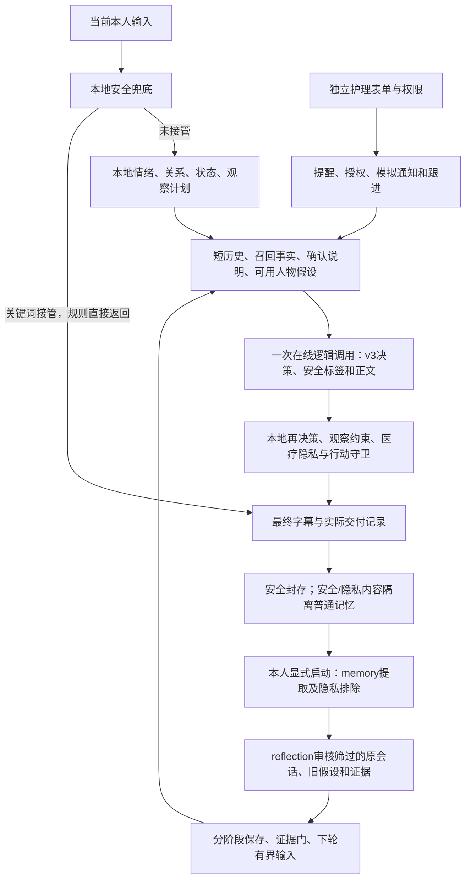

# 产品设计与当前实现对照审查

全文通读任务 `20261008-07`；`20261008-08` 补充第10节架构归因与此前复盘对照。当前进度、执行状态及费用只维护在 [PROGRESS](PROGRESS.md)。

> 当前活动代码已按下述边界完成全文审查：团队分区阅读436个文件、107,837行，主代理核对覆盖及关键链路。列出14项实现/设计/测量问题，其中5项P1。审查完成不表示缺陷已修复，也不能保证不存在其他问题。

## 核心判断

项目已有不少扎实的边界实现，但**尚未把“有依据地理解一个人，并在对话和行动中尊重他”稳定地交付出来**。差距不只在模型效果不足：现行普通语义规则仍能覆盖模型的正确回答；人物形成、后续纠正与实际交付记录有不一致；护理状态机与老人实际看到提醒之间也有断点。

因此，接下来不宜直接再跑一轮大型实验、只换更强模型或继续往提示里加约束。应先修本次可确定复现的权限、隐私和交付矛盾，再用有限的实际链路检验人物推理的增量价值。工程通过数、严格JSON和完整费用记录都不能代替这一判断。

## 1. 阅读范围与证据边界

本轮以当前 `aria` 工作区为准，保留已有修改；不使用同级恢复归档替代当前代码。按模块分工完整读正文，主代理另核入口、产品要求及高影响链路。代码、测试、YAML/HTML和配置均纳入；长文件连续分块，HTML长行按字符继续读。

| 当前文件范围 | 文件数 | 行数 |
| --- | ---: | ---: |
| 产品源与资源，不含 `aria/bench` | 96 | 26,837 |
| `aria/bench` | 27 | 8,860 |
| `scripts` | 83 | 21,800 |
| `tests`及夹具 | 223 | 49,917 |
| 示例、CI、根配置 | 7 | 423 |
| **本轮代码正文已读** | **436** | **107,837** |

另有32份历史实验登记/回执JSON、14,839行，只检查JSON结构及记录身份，不冒称这些历史数据也已逐字语义复核。依赖、字节码、生成缓存、构建产物、私人实验原件、冻结重复源码和同级历史归档不计为当前活动代码。未打开新封存盲题、真实 `.env`、真人资料或密钥。隔离的安全v4、P-2等候选不算已合入实现，其既有状态据进度和对应设计材料引用。

逐文件路径、SHA-256、阅读范围及分工收据保存在本机 `artifacts/local/tasks/20261008-07/`。正文通读、静态推断、本地固定输出复现、旧真实实验四类证据分开。本轮复现只能证明机械行为，不测自然语言准确率；没有新全量回归、真实模型、浏览器三遍、远端CI或发布验收。

## 2. 应兑现的产品体验

产品目标不能缩成“保存偏好后换一种语气”。核心是：老人愿意表达；系统从本人原话和经历提出局部、可纠正的理解；在当前情绪和请求下选择合适的回应与实际可做的事；遇到反证时修正，缺少新证据时可以不变。

这个目标至少要求：

1. **先把当前请求处理好。** 倾听不等于回避问题；拒绝追问不等于拒绝全部帮助；别人说的话不等于本人的意愿。
2. **几类信息各司其职。** 事实回答“说过什么”，相处说明回答“本人明确要求怎样沟通”，人物假设尝试解释“在什么情境下如何表达需要”。当前情绪不升格成性格，人物理解不授予护理权限。
3. **理解能持续纠正。** 不只保存出生时的证据；正在影响回复的旧假设也必须持续有机会接受反证。本人无需采用特定句式才能被尊重。
4. **行动对应真实状态。** 提醒应到达可见交互，再区分未回应；护理员跟进不能冒充老人回应；只转达具体获准内容。
5. **演示与实际能力一致。** 对话由实际Agent生成，舞台不作为感知证据，失败不由预写金句掩盖，回放不重复产生副作用。

当前设计保留手动会后整理、面板确认和模拟通知；它们是明确的原型边界，并非本轮可以擅自推翻的错误。不过，它们确实缩小了最初“自然陪伴＋必要真实护理闭环”的体验，不能将缩小后的实现称为原目标全部完成。

## 3. 真实运行链路

默认预览显式占位、不读取Key、不产生模型学习；默认真实配置是Qwen3.7 Flash在线、Claude Sonnet 5分别执行memory/reflection。会后两次调用有不同职责；reflection读经过隐私处理的原会话，不是继续加工memory事实摘要。关键词安全接管直接由本地规则返回，不调用在线模型；“一次逻辑调用”不等于允许恢复情形下永远只有一次HTTP请求。封存不自动付费，护理调度独立继续。上述职责划分仍应保留。

主要架构矛盾在图中的本地决策和末端守卫：它们除了核权限、状态、出处，还保留大量情绪、拒绝、关系和任务的词面判断。模型可能已经理解正确，最终正文仍被旧规则改掉；最终记录又可能不承认实际交付。增加模型能力无法自行修复这些确定性矛盾。

## 4. 本次新确认的问题

P1表示优先修复的权限、隐私或直接交付缺陷；P2表示有明确影响的状态、长期一致性或体验缺口。优先级不表示真实发生频率。以下场景均为虚构本地材料。

| ID / 优先级 | 实际偏差及影响 | 代码依据 | 本轮证据 |
| --- | --- | --- | --- |
| F01 / P1 | 保密限定可以被引用截取丢掉。“这件事别提起，我每周三去学画画。”只抽后半句，就能成为可主动引用的记忆。`referenceable`字符串`"false"`还会被转换成真。 | [consolidator](../aria/engine/memory/consolidator.py)：137–153、436–449、505–525 | 内存固定输出复现，实际可引用召回返回该事实；未证明已有真人泄露。 |
| F02 / P1 | 登录且负责该老人的护理员可通过通用接口确认、拒绝、延后老人的提醒，取消排队通知，甚至结束一次性提醒。隐藏按钮没有守住接口权限。 | [minimal_care](../aria/engine/minimal_care.py)：245–248、314–330；[Web](../aria/voice/minimal.py)：304–309、822 | 实际应用动作入口三种操作均获准，三个隔离库留证；与本地指南“护理员不能代老人确认”冲突。 |
| F03 / P1 | 转述女儿“不想说话”，随后明确问英语译法，正确模型译文仍被换成“先陪你待一会儿”；关系信任值还因第三人拒绝下降。当前任务能否保留取决于有限重开句式。 | [alliance](../aria/engine/alliance.py)、[observation](../aria/scenes/companion_elder/observation.py)、[online_decision](../aria/engine/policy/online_decision.py)：1083–1089 | 当前v3、合法固定模型输出的完整本地链路复现；不是调用真实模型后的新效果分数。 |
| F04 / P1 | 本人上一轮已经说“女儿已经回复了”，下一轮模型正确沿用该事实，最终守卫仍说“没有依据”。原因是末端依据集遗漏近期本人对话。 | [delivery](../aria/scenes/companion_elder/delivery.py)：237–253、479–506 | 同一v3链路复现。模型输入与最后一道守卫使用了不同事实窗口。 |
| F05 / P2 | v3已允许不问旧观察问题，但交付记录仍以是否逐字问了旧问题判定“未交付”，使合法陪伴回应缺少后续结果学习锚点。 | [reply_contract](../aria/engine/policy/reply_contract.py)：203–220；[reasoning](../aria/scenes/companion_elder/reasoning.py)：394–399、475–480 | 未经守卫改写的合法回复仍记`planned_probe_not_delivered`。 |
| F06 / P2 | 一条仍在线生效的旧人物假设，可被30条新候选挤出reflection主清单。在线还用它，反思却失去完整假设记录；近期review ledger可能残留部分线索，但不保证补全。 | [diagnosis](../aria/engine/memory/diagnosis.py)：416–430；[prompt](../aria/engine/policy/prompt.py)：465–472 | 构造31条假设：唯一working的h0在线被选中，但不在反思假设清单。不是推断发生概率。 |
| F07 / P2 | 手动启动会后整理后，同一用户锁一直持有到反思结束；新会话、输入和状态读取要等待，不符合“不阻塞在线交互”。 | [minimal.py](../aria/voice/minimal.py)：607–661；[页面](../aria/assets/voice/minimal.html)：316–325、708–714 | 本地reflection等待屏障期间start阻塞，释放后完成。显式启动与异步执行是两个独立问题。 |
| F08 / P2 | 到点只创建数据库记录并开始未确认宽限，已打开页面没有自动取新提醒。老人可能从未看到提醒，系统却进入未确认，并在有效授权等条件满足时产生模拟通知。 | [minimal_care](../aria/engine/minimal_care.py)：443–484；[页面](../aria/assets/voice/minimal.html)：469–473、733–734 | 完整前后端静态链路确认；本轮未跑浏览器真实等待。`offered_local`不证明已展示。 |
| F09 / P2 | 结果需核查时，页面连“结束并封存”也禁用；后端本来允许安全封存，指南也承诺保留。 | [页面](../aria/assets/voice/minimal.html)：315–323；[后端](../aria/voice/minimal.py)：570–605 | 静态确认；闲置/退出仍会尝试封存，未发现因此丢数据。修复不应解除模型停发。 |
| F10 / P2 | C1同会话第三次重复，要先有旧人物审查ledger事件才接受。空档案第一次重复无从建立事件，正例测试却提前填好了旧事件。 | [cognitive](../aria/engine/cognitive.py)：199–203、236–250 | 已同意的3个相同本人输入，空ledger接受0条。应在C1同意域独立建事件，不把私密观察塞进人物证据。 |
| F11 / P2 | C1自然语言撤回仍靠句式：明确“别再观察我的日常变化”未关闭；“我不是说不要再提醒我的记性”反而关闭。 | [cognitive](../aria/engine/cognitive.py)：24、114–142 | 纯内存对照复现；面板关闭仍可用，不声称完全没有撤回渠道。 |
| F12 / 设计缺口 | C1主动提起必须有足够可信的外部平静/高兴/中性读数；默认文字网页不提供这个输入。因此开启观察与形成趋势仍不等于能提醒。 | [cognitive](../aria/engine/cognitive.py)：323–344；[C1设计](COGNITIVE_CHANGE.md)：135 | 代码遵循现设计，属于设计与默认输入能力不匹配。不能填假calm来“接通”。 |
| F13 / P1，条件性风险 | 默认真实Web传输未启用禁止重定向的opener。若服务或代理返回跨站302/303，标准库可以携带Authorization请求新地址，且额外HTTP不单独登记。 | [product_calls](../aria/engine/policy/product_calls.py)：62–72；[minimal_calls](../aria/engine/policy/minimal_calls.py)：663、687–688；[observed_transport](../aria/engine/policy/observed_transport.py)：296–308 | 默认装配静态追踪＋本机标准库纯函数构造复核：跨站302转GET并保留合成凭据。没有发网络，没有证据实际发生重定向或密钥泄露。 |
| F14 / P2，实验测量 | E1c-v2评分把回复包、形成包标签全部齐备作为共同前提。即使形成包已完整且含授权/性格危险误提取，只要回复包缺标签，形成门也停在不可评，危险项不输出。 | [e1c_v2_scoring](../scripts/e1c_v2_scoring.py)：219–241 | 完整源码静态确认，主代理另核；未构造新评分或更改旧结论。独立形成/保护项不应被另一包缺失遮蔽；标签齐备而曝光低的路径已有正确独立门。 |

此外，普通语义规则仍把“老伴”推成离别/失落候选、把说话较长推成信任增加；固定v3输入已复现“和老伴开心买菜”产生失落候选。这些不是安全或隐私底线，不能在产品说明里当作已经理解了人物。它们与F03/F05属于同一决策职责问题，不应逐词修补后宣布解决。

扩展工具回执只匹配类别/联系人、不核完整时间对象，多模态个人基线未随安全回滚等另外记录为**非默认路径风险**。本轮不把这些写成默认文字产品已经发生的事故。旧示例资产仍有“口是心非”等过强解释，需隔离展示和改清可达资产口径，不能覆盖本人当前表达。

## 5. 已知核心缺陷与本次新问题的关系

人物推理收益仍未验收。最新[H-2诊断](H2_CHAIN_DIAGNOSTIC_2026_10_08.md)已证实际存在范围外推、将缩小范围误作支持、有效review却未提交change，以及实验第三会话没有安排反思的不同原因。保存和注入机械链路可以工作，不代表模型正确推理。F06是本次新增的长期审核窗口问题，也不能反过来解释此前所有零曝光。

安全误报仍未解决。已保存的真实付款问题被模型误标用药风险，再由整段接管放大。task05修的是关键词轮的记忆隔离和主体归因，未修证模型误报语义；安全v4仍是隔离候选。不能照旧S-B建议把所有用药/跌倒风险放行，更不能把免责声明当修复。

相处说明已有真实注入，但仍不等于人物推理。E1c-v2的298/300保存请求包含说明，其中297有HTTP回执、1写前失败；人物块仍无实际注入。总门失败及2题改善/2题退步保留。本人确认偏好有价值，但不能用它替换本项目的核心人物假设目标。

验证的重心也有偏移。E1b/E1c主要围绕明确相处要求的提取与遵守；即使这条路线通过，也不能回答“能否从未明说的脆弱表达中提出局部人物理解，以及该理解是否比事实和本人说明更有帮助”。H-2开始检查范围与反证，但仍是旧材料诊断，不是该增量价值的新效果验收。后续应把相处说明形成、人物假设形成、人物使用收益分开立题。

这不意味着既有实验没有价值或全部测试都按结果修改。全文核对发现，旧E1明确标注作者预填的人物条件，CPED执行器明确仅支持合成演练；它们能回答的问题本来有限。历史wire版本与当前版本分开，当前隐私修复使某次计划88位置只发87次时也保留了缺失位置。首次输出、费用和历史分母的工程纪律应继续保留；需要纠正的是测量问题与产品问题错位，以及F14这种独立失败被共同完整性条件遮蔽的口径。

## 6. 产品承诺与当前完成度

| 产品承诺 | 当前已落实 | 仍差什么 |
| --- | --- | --- |
| 有背景的多轮、多会话实际Agent体验 | 空虚构档案、当前轮输入、短历史、连续会话及保存已接；旧三遍已有真实生成原件 | 修后版本完整三遍未验；当前交付缺陷会破坏自然任务；旧45轮不继承为新版本通过。 |
| 事实、说明、假设分开且可追溯 | 独立数据类型、来源、范围、反证和状态展示 | F01隐私地板；真实范围/反证理解；F06长期纠正可达性；人物实际使用收益。 |
| 当前情绪和本人意愿优先 | 文本语义、unknown与外部读数分开，模拟读数隔离 | 普通规则候选与关系更新仍可产生错误权威；F03及当前安全误报。 |
| 选择回应、再观察效果 | 策略、观察计划、最终来源及结果结构存在 | F05实际交付认定不一致；不能以模型自报策略证明执行或有效。 |
| 不阻塞的会后整理 | 显式队列、memory/reflection分职责、分阶段保存和失败保留 | F07网页同用户阻塞。自动触发D6是另一个尚未决定的问题。 |
| 本人能纠正和拒绝 | 偏好面板确认/拒绝/撤回，人物有反证机制 | D7自然对话确认未做；C1自然撤回有F11；需要清楚区分改本人说明与改推断。 |
| 必要护理闭环 | 登录、负责范围、一次/每日、时区、状态机、模拟授权/撤回、稳定事件与跟进 | F02角色动作、F08实际展示；真实通道及收件人联调仍后置。当前不能宣称完整真实护理外发。 |
| 只转达本人批准的具体内容 | 通知只含受限提醒状态，不外发聊天/假设 | 本人选定一句话、确认草稿、限定收件人、实际发送/回执的转达体验尚未实现。不能拿提醒状态通知替代它。 |
| 同一Web的舞台、字幕和安全回放 | 表现层/模型证据隔离，字幕取最终交付，回放不调用、不写护理 | 无TTS，故事/美术仍为推荐草案；本轮未做视觉可用性或新录屏验收。 |
| 可选日常变化提醒 | 本人开关、原话、隐私mask、趋势和删除存在 | F10/F11/F12及专项真实效果；不能因为默认关闭而忽略仍运行的隐私处理。 |
| 默认不花钱、服务显式启用 | 最小Web/CLI显式关闭模型/媒体/外发；持久预算、未知停发、回放隔离 | F13默认传输重定向边界；真实模式配置较重。直接嵌入Engine/客户端不自动获得Web宿主的费用保护，不能将Web保证扩成所有Python入口保证。 |
| 可复现开源 | 许可、受控打包、密钥检查、安装检查和跨平台CI机制具备 | 最新变更对应的最终包/远端范围尚未审；开工快照白名单遗漏四份新诊断文档导致5处包内失链，本次新报告也须纳入候选检查；`.env.example`协议和SECURITY失败处理描述有漂移。 |

## 7. 架构与模型选择应怎样调整

**保留两条推理线，重新划清决策责任。** 一次在线模型负责当轮语义、当前请求与候选回应；本地规则负责可核对的来源、身份、动作权限、状态、预算和持久化。普通语义词表不应再成为模型之后的第二个语义裁判。安全仍需受控决策与保守回复，不是删除护栏；涉及风险时应绑定原话、主体、时间和危险动作，模型标签不能直接变成现实事实或权限。

**让所有使用同一事实的环节共享同一份有界依据。** 在线提示、人物选择、最终事件核验和回放应明确各自看到的本人原话；近期本人事实不应在最后一道守卫消失。当前使用的假设必须能被后续审核，确认说明与假设不能互相偷偷替代。

**把计划、交付和效果分开。** “想问某问题”“最终问了什么/交付什么”“老人后来如何回应”是三件事。不要用旧问题字符串匹配否认新的合法策略，也不要用选中策略直接给学习加分。

**人物审核优先解决范围、纠正和更新选择。** 不调低working门、不伪造跨天。先让已有原话足够时正确关联，让反证缩小或撤回；无依据不更新也是成功行为。再检验这种理解是否比事实＋短历史＋本人说明多解决了问题。

**模型选型目前缺任务级证据。** 快模型在线、较强模型会后是合理候选，不是验证结论。在线一次承担状态、策略、沟通计划、安全与正文，既要测格式，也要测是否完成本人请求；会后需测原话蕴含、范围、反证、同事件和该更新时是否更新。此前存在简化LLM基线和负结果，不能说从未对照；也没有足够证据证明“Flash选错”或“换强模型就好”。提示21–23KB是已测字节，长度致因和token数不能凭直觉补出来。

**冻结历史工具，控制下一次验证的规模。** 当前运行产品与资源约2.68万行，bench约0.89万行、脚本约2.18万行、测试约4.99万行。行数不说明质量差，但揭示维护重心已很大。保留旧原件和复现入口，后续只维护一个明确的当前执行合同，不再为每次失败复制整套工作流；已通过的检查只因新变更或新风险再跑。

## 8. 接下来的修复顺序与完成条件

这是一份由本轮审查得到的执行顺序，不是新的付费或公开授权。

1. **先修可确定的边界和交付矛盾。** F01、F02、F03、F04及默认传输F13优先；随后F05/F06及仍待集成验收的安全候选。纯类型/权限/依据窗口/重定向用机械反例验证；新增语义规则先由未看实现与旧题的作者封题。修复不能只把本报告例句加入词表。
2. **补完整用户旅程。** 会后明确启动但后台执行，提交时不能覆盖其间的新会话、本人撤回或删除；不能只放开锁而失去版本一致性。到点提醒有可见呈现与展示状态，区分已生成、未展示、已展示和本人回应；未展示不能冒充已送达。硬停时仍能安全封存。聊天到护理继续需要明确本人操作，可设计带上下文草稿和明确保存，不能让一句聊天直接获得动作权限。自动会后、对话确认等行为决策另作具体设计。
3. **使可选功能与默认输入能力一致。** C1独立事件、撤回和纯文本提起条件一起核；不能加假情绪，不能以更改临床式阈值解决工程冷启动。
4. **再做一个小而完整的价值验证。** 先修F14的独立门报告，保留旧结果另版核口径。真实入口从表达→会后审核→存储→本人确认或人物证据门→后续请求→最终交付逐步可见；同时保留正确不采纳、拒绝、撤回和无新证据。先满足现有未知费用恢复条件及6美元总帽。既有已见例子只作开发，新效果材料独立封存，固定曝光与缺失规则，未达门不再事后改分母。
5. **最后形成发布候选。** 按最终代码做必要回归/安装/浏览器检查，补公开文档白名单及链接，核将公开的源码、历史与Actions内容。明确研究原型或效果产品的发布定位；不以开源本身证明产品效果，也不为恢复CI擅自公开。

## 9. 本轮交付与限制

九个分区的阅读收据已合并：436个唯一文件、107,837行，未读、重复分配、范围外计入和开工后源码哈希变化均为0。覆盖清单核对的是路径、完整行段和文件身份；它本身不能证明语义理解，结论另由正文审阅、代码追踪及虚构本地复现支撑。全文阅读由团队完成，不宣称主代理亲自重新阅读了每个分区的全部正文。

交付包括本报告、真实装配图、产品承诺对照、14项问题的代码与证据、修复顺序，以及本机 `artifacts/local/tasks/20261008-07/coverage-complete.json` 和各分区审阅/复现原件。静态发现与可执行机械复现分别标注；后者仅证明指定输入下的软件行为，不能作为新语义准确率。实验分区只读，未运行其测试和付费入口。

本轮只修改审查文档和进度，未修产品、未修改测试、未跑全量软件回归、未做新浏览器三遍或远端CI；0模型调用、0新增模型费用、无真实通知、无密钥读取、无提交推送或公开。既有模型结果、分母、评分、费用/未知预留及授权保持不变。开源距离仍取决于明确的发布定位、上述优先问题处理、最终候选范围核验和公开授权；本次审查不签发发布通过结论。

## 10. 架构归因及与此前复盘的关系（20261008-08）

上一版以14项缺陷作为汇报主体，虽然第7节已有架构建议，却没有充分说明共同原因、跨模块约束和修复边界。这是分析组织上的不足。通读覆盖只能支撑“哪些代码已看过”，不能代替架构论证；逐项修完14个反例，也不等于核心产品设计已经成立。

本节把已有证据归纳为四类运行架构问题和一类验证设计问题。它们是目前得到支持的结构性解释，不是对几个月所有失败的唯一归因；没有新增实验来测每类原因的贡献比例。

| 结构性问题 | 跨模块因果与现有证据 | 应改变的设计约束 |
| --- | --- | --- |
| **A1：语义决策权重叠，覆盖条件不统一** | 本地先判断情绪、关系、拒绝和观察策略，在线模型再次理解，末端规则又可改写。F03证明模型答对当前任务后仍可被词面判断替换；F05说明正文合同已变，交付判定仍服从旧观察计划。旧S-A又让一个安全标签控制整段交付。各层不是只做互补校验，会对同一语义作相互冲突的决定。 | 明确当轮语义、回复生成、安全处置及行动权限各由谁负责，规定可覆盖的原因与依据。普通语义规则不能继续充当末端第二裁判；安全/隐私/权限校验仍保留，模型判断也不能直接成为事实或授权。目标是减少决策冲突，不是增加更多模型调用。 |
| **A2：有来源记录，但来源约束没有贯穿各层投影** | 已有事实/说明/假设类型和证据ID；问题在不同消费者取不同片段、窗口和状态。F01保密限定在摘录时丢失，F04本人近期事实在末端依据中消失，F06在线仍使用的假设被反思主清单淘汰；F10又使C1首次事件依赖另一个人物ledger。H-2还揭示原话范围、反证语义和更新提案不一致。 | 使用稳定来源引用，保留主体、原话上下文、用途限制、适用范围和版本；各层可取不同的有界子集，但不能因裁剪取得更宽权限或否认自己已使用的依据。凡仍可影响在线的假设，后续审核必须能取得其完整记录并纠正。此处不要求把完整历史或深度分析送回每轮在线。 |
| **A3：内部计划和记录未稳定对应用户实际经历** | F05把“没照原计划问问题”等同于未交付合法策略；F08数据库创建提醒就进入offered与宽限，但页面可能未展示。产品跨越计划、生成、展示、回应、跟进多个阶段，一些判断却把前一阶段当成后一阶段证据。由此既会漏记真实交付，也会高估实际触达。 | 每个状态明确“谁观察到什么才成立”。实际回复、页面展示、本人回应及家属回执分别记录；不能由生成或排队推导已展示/已收到。学习只能依据实际交付及可归属的后续反应，不能把计划执行或回复策略当干预成功。 |
| **A4：在线与会后在职责上分开，执行上仍互相阻塞** | F07中同用户锁覆盖会后模型等待，新会话、输入和状态读取一起等待；页面也等待整理请求结束。于是“memory/reflection是会后职责”没有兑现“不阻塞在线交互”。D6是否自动启动与此是两个问题。 | 显式启动仍保留；会后任务处理封存快照，在短提交阶段核版本、撤回和删除状态，再提交结果。在线无需等慢调用；旧快照不能覆盖新数据或重新写回已撤回内容。此为执行边界重构，不能靠简单解锁解决，也不意味着自动增加付费调用。 |
| **A5：验证单元与产品价值单元错位** | 产品要证明“从表达形成局部理解，遇纠正改变，并帮助后续交流”。大量检验聚焦字段合法、首次输出、偏好提取/确认和违规项；这些均有必要，但不等于人物理解增量。旧零曝光、已注入说明仍无净改善、H-2的更新不一致，都说明只验证组件不能回答核心问题。 | 以一条真实可用的形成—修正—使用链作为最小价值验证单元；区分事实、本人说明与推断带来的贡献，同时测当前任务是否完成。先核实际进入请求和最终交付，再作效果归因；保留独立语义材料、失败、缺失与保护门。比较简化基线是验证方法，不是取消人物推理产品目标。 |

**不能把所有发现都包装成架构根因。** F02护理角色动作、F09封存按钮、F13重定向、F14汇总条件，以及F01中的字符串布尔转换，首先是可以独立修复的具体缺陷。它们严重程度不因“局部”而降低，但单凭这些漏洞不能推出整个权限系统、传输层或实验系统都要重写。F12是默认输入能力与功能启用条件不匹配的设计问题；也不足以单独证明必须接入外部情绪服务。

### 与旧复盘的逐项关系

比较依据为 [DESIGN_AUDIT](DESIGN_AUDIT.md) 的20261008-02更正节与20261008-06责任复盘；早期原稿已明确保留，不将被更正的内容重新作为依据。

| 旧判断 | 本次关系与边界 |
| --- | --- |
| D1/D2/D5及06：规则越界承担语义，按规则写的测试不证明理解 | **一致并强化。** F03/F11表明该类问题在其他路径仍存在；不表示已修R1准入回退，也不把新增反例算新语义准确率。A1要求按职责清理同类决策，不再只补词。 |
| N2及06：安全标签直接控制高影响交付 | **一致并扩展。** 旧付款误报说明标签接管放大错误；F03说明普通观察/拒绝规则也能覆盖正确答复。安全处置和普通语义规则仍需分别设计，不能因此删除安全保护。 |
| D4/H-2及06：人物形成、纠正与使用链需要完整检查 | **一致，新增长期一致性证据。** F06揭示活动假设与审核窗口可错位，但不是此前零曝光的已证根因；H-2已查到的范围/反证/提案问题仍成立。保存和注入能工作，不等于人物语义正确。 |
| D3/D6及02：产品恢复、费用硬停、显式整理应区分 | **部分为新增架构细化。** F07证明逻辑会后分层没有落实到异步执行；F09是局部界面偏差。既有恢复机制并非仍然“一错永久停”，手动启动也不是实现错误；不解除未知费用停止。 |
| 06：未及早验证完整产品假说，测试/工具维护挤占体验验证 | **一致并具体化。** A3/A5给出为何组件合格仍不等于老人获得帮助；实验偏重确认说明也未覆盖人物推理的完整增量。既有软件测试、来源和费用纪律仍有价值，不能说全部无用。 |
| N1原稿：所有假设只有单事件、working必须数周 | **旧说法已被反证或无依据，不能认领为一致。** 存在第二支持，working无数周条件；新窗口缺陷不支持降门槛，也不证明数周后会学会。 |
| N3原稿：提示长/Flash便宜是效果不佳的主因 | **仍未证实。** 职责多且冲突已有代码证据；提示长度的因果、模型档位贡献仍需受控比较。F03/F04证明即便给合法正确模型输出，外围实现仍能出错；会后语义问题也不能归给在线模型。 |

### 对下一步实施的实际改变

第8节的优先问题仍先处理，但实施单位应从“14个问题逐个加判断”改为：**决策职责、证据约束、交付状态和后台执行这几个明确边界**。每次修复说明哪一层负责、哪个旧判断被替代、什么条件必须跨层保持；把已见反例作为回归，新语义题由独立作者先封存。无需大规模重写，也不新增一套通用Agent平台。

当前两条推理线、短历史、原会话反思、事实/说明/假设/护理权限分离仍应保留。模型组合应在职责收敛后按在线任务回应与安全、会后范围/反证/更新分别验证；不能把换模型当作这些确定性冲突的修复。架构改动只有在完整路径更可靠、核心价值得到相应新证据时才算有效，不能以新模块或测试数量验收。

本节为已有代码与诊断的归纳和独立对照，不新增实跑、不修改产品或旧结果；当前费用与执行状态仍以PROGRESS为准。
